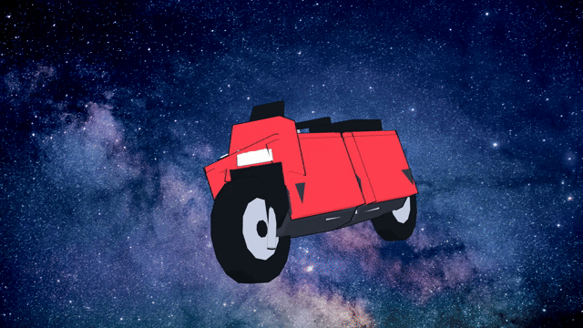
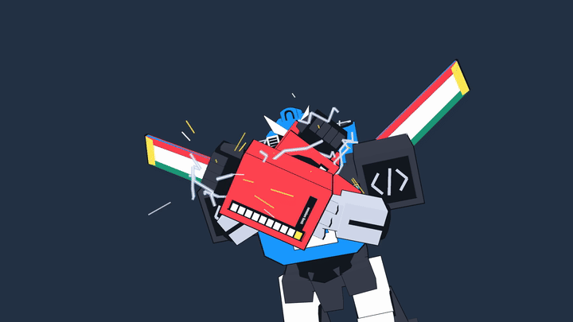
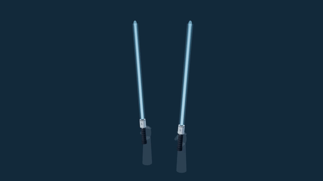
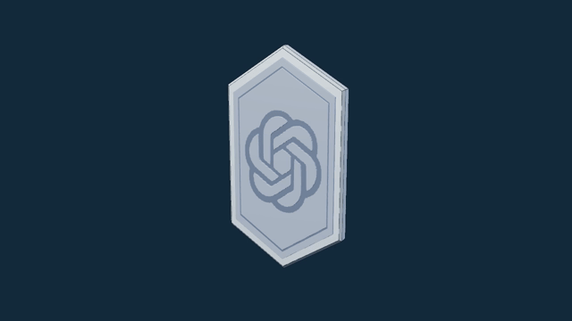
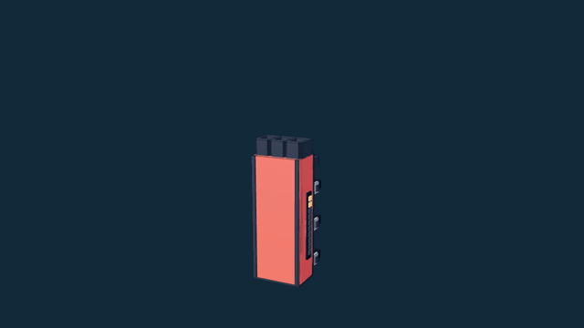
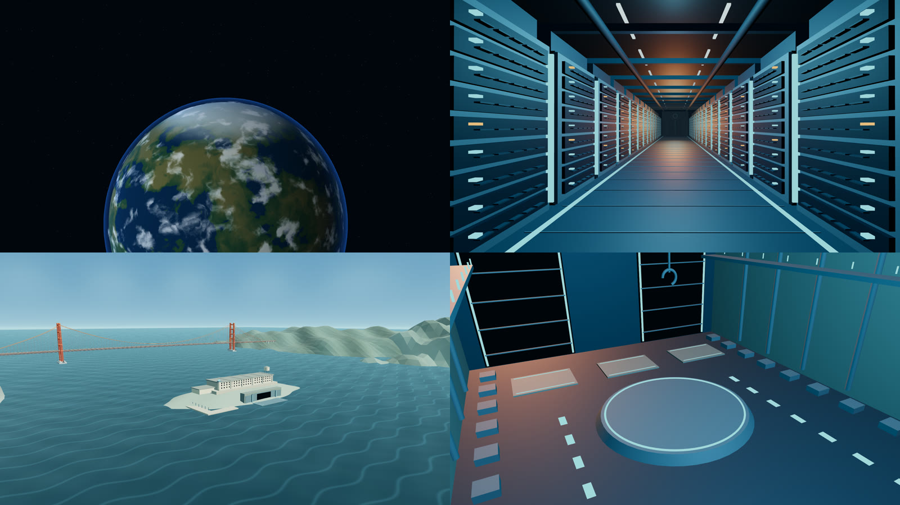

# Sentai Production Studio
### 3D Assets for Tokusatsu

**Reusable robots, transforming vehicles, hero weapons and filming sets for hand-drawn tokusatsu animation. Built in Three.js. No Blender.**

Created for [@The_singularity_is_coming](https://www.youtube.com/@The_singularity_is_coming). These procedural 3D assets support shot blocking, animation reference and artist-led tracing. They are not a text-to-video generator.

**Production-bank collection published: November 14, 2026.** The robot demo predates this expanded collection. Git history records the successive implementations and publication changes; this date documents this release, not a claim of worldwide priority.

## Vehicle launch and combination



## Robot action



## Hero weapons

### Gemini — Flash blades



Black grips, silver engraved sleeves, four single-colour beam modes, and pommel-to-pommel docking.

### GPT — Constellation shield



A hexagonal shield follows star points, draws a constellation trail, and unfolds into a 37-tile wall or enclosing sphere.

### Claude — Session claws



Three full-length white claws slide into a heavy forearm case. Three straps, a palm grip and a session-limit gauge complete the prop.

Open the [weapon viewer](environments/weapons_bank/index.html) locally; see its [guide](environments/weapons_bank/README.md) for transparent PNG exports and layers.

## Reusable production sets

| Set | Local viewer | Guide |
| --- | --- | --- |
| Golden Gate, day / sunset / night / dawn | [Bridge](environments/golden_gate_bank/index.html) | [Guide](environments/golden_gate_bank/README.md) |
| Robot sea-split flight | [Action](environments/golden_gate_bank/action_viewer.html) | [Guide](environments/golden_gate_bank/ACTION_README.md) |
| Space, data center, Alcatraz base and hangar | [Production sets](environments/golden_gate_bank/production_viewer.html) | [Guide](environments/golden_gate_bank/PRODUCTION_README.md) |
| SF downtown, reversible destruction and parallax | [Latest city viewer](environments/sf_downtown_bank/index_v2.html) | [Guide](environments/sf_downtown_bank/README_v2.md) |



Download the repository, serve its root with `python3 -m http.server 8766`, and open the desired HTML file at `http://127.0.0.1:8766/`. GitHub file pages display source rather than running the viewers. Runtime dependencies are bundled locally. Source drawings and bulk intermediate frame sequences are not included.

## Open

- `index.html`: fusion lab, vehicle modes, six mechanisms, palette-driven toon rendering.
- `showcase.html`: hero camera, face-front X charge, downward arm release, screen-filling spark burst, clean final pose, and knee-height Dutch-angle run.

Open either HTML file in a desktop browser. Keep the included folder layout. Three.js r149 UMD is bundled locally.

## Hero shot timing

| Time | Action |
| --- | --- |
| 0–1.10 s | Crossed fists in front of the face; high camera; continuous electric arcs and sparks. |
| 1.10–1.85 s | Arms spread down and outward; camera follows the descending hands. |
| 1.55–2.10 s | Camera pulls back and drops to the low-angle full-body composition. |
| 2.05–2.47 s | One large radial burst expands out of the frame and disappears. |
| 2.47–4.50 s | Clean full-body hero pose, no remaining sparks. |

The running camera sits at model height 9, near knee height, with an 18-degree Dutch angle. Both shots are sampled at 12 poses per second and exported as 24 fps two-frame holds. Spark geometry uses deterministic seeds and pooled meshes.

## Files and interfaces

- `antigravity_king.js`: original combining model; `window.AntigravityKing.build(palette)`.
- `motion_rig.js`: independent pose rig; `window.MechaMotionRig.build(robot)`; `cross(seconds)` and `run(seconds)`.
- `hero_effects.js`: pooled lightning and burst geometry; `window.HeroEffects.build(scene, palette)`.
- `showcase.html`: camera choreography and preview; `window.MotionLab.render(shot, seconds, width, height)`.
- `tools/capture.mjs`: PNG capture through a local Chrome debugging connection.
- `tools/encode.py`: FFmpeg encoding of captured transparent frames.
- `tests/verify.mjs`: browser-level motion, framing, and timing checks.

The shot rig resets all transforms before each pose, so seeking and out-of-order sampling do not accumulate joint rotations. Feet are solved from ankle targets. The X pose uses forward/inward shoulder travel and a telescoping upper-arm frame; it is an animation rig, not a collision-free physical mechanism.

## Capture

Start a local server from this directory:

```sh
python3 -m http.server 8766 --bind 127.0.0.1
```

Launch a separate temporary Chrome profile with remote debugging on port 9222. Install Deno and FFmpeg if using the optional capture tools. No dependencies are needed just to open the HTML previews.

```sh
deno run --allow-net=127.0.0.1:9222 --allow-read --allow-write tools/capture.mjs cross captures/cross_frames
deno run --allow-net=127.0.0.1:9222 --allow-read --allow-write tools/capture.mjs run captures/run_frames
python3 tools/encode.py captures exports
deno run --allow-net=127.0.0.1:9222 tests/verify.mjs
```

The MOV output uses the lossless QuickTime Animation codec, not ProRes. WebM carries VP9 alpha. PNG sequences are the source of truth. Editor support for alpha must be checked in the target application. Preview MP4 files have a solid background and do not carry alpha.

## Repository scope

This repository contains robot, weapon and environment viewers, reusable source modules, selected review renders and capture tools. Original drawings, personal paths and bulk intermediate frames are excluded. The private production repository remains separate.

## Third-party runtime

Three.js r149 is distributed under the MIT license. Its required notice is preserved in `vendor/THREE-LICENSE.txt`. The project-specific robot design and demo code are provided for viewing; no additional license is granted for them. Three.js retains its own MIT license. See `LICENSE-NOTICE.txt` for the project-specific licensing scope.
