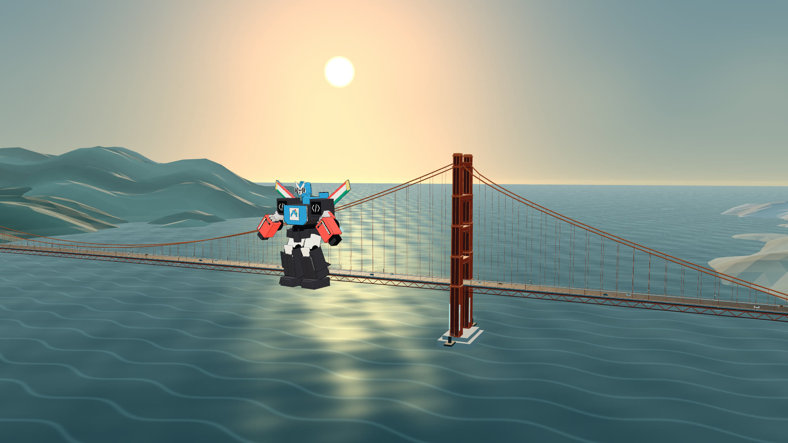
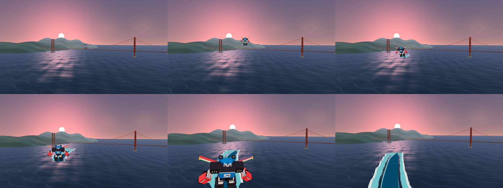

# Golden Gate — Robot Flight and Sea Split

Open `action_viewer.html` from the same local server as the environment viewer. `index.html` and its original five camera presets are preserved.





## Shots

- `op_final`, six seconds: dawn; approach from behind the bridge, clear the deck between towers, descend over the ocean while progressively leaning forward to 45 degrees, approach/pass the camera with a short deterministic shake.
- `hero_hover`, five seconds: sunset hover beside the south-side tower. The 1.5-second still is the presentation hero frame.

The existing model and motion rig are copied byte-for-byte from the public robot package into `robot/`. The public repository is not edited. No new helmet or character design is introduced. Low flight keeps the posed model at least six world units above the analytic water baseline; the wake uses the nominal path anchor. The flight wrapper resets to identity before asking the original world-coordinate rig for a pose, then applies world placement and the single `robotScale` parameter.

Robot, bridge, cables, water and wake are in one Three.js scene and use one depth buffer. Beauty renders have geometric depth occlusion; they are not image-layer composites.

## Reusable wake

```js
const wake = addSeaSplitWake(scene, path, {
  speed: 1, width: 90, depth: 14, sprayHeight: 26,
  trailSeconds: 2.1, waterLevel: 0
});
wake.bindWater(waterMesh);
wake.update(seconds);
wake.setParams({width: 110, sprayHeight: 34});
```

`path(seconds)` returns `{position: THREE.Vector3, clearance: number}`. Clearance is the distance of the low flight anchor above water. The module carves the bank's water shader along a 32-sample trail and fills the split with a recessed floor, two cel-style spray walls, crest foam and pooled spray shards. It samples absolute time; seeking and out-of-order rendering do not accumulate particles or geometry. Speed scales both the flight path and wake sampling in the supplied action wrapper. Changing speed changes the distance traveled during the six-second viewer interval.

The wake is stylized geometry, not a fluid simulation. Its `bindWater` adapter expects the bank's water shader signature; another water renderer needs its own cutout adapter. Do not bind more than one wake to the same material. A future base launch can supply another path.

## Viewer and exports

Viewer controls: shot, beauty / robot / wake / environment / bridge, robot scale, forward lean, speed, trench width/depth, spray height, time, playback, 1080p PNG export.

```js
ActionLab.render('op_final', 3.8, 1920, 1080, 'beauty');
ActionLab.action.setParams({robotScale:4, flightLean:45, speed:1, width:90, depth:14, sprayHeight:26});
```

`robot` and `wake` are isolated alpha assets; `bridge` is structure on alpha; `environment` omits the bridge and robot. These isolated passes do not include depth mattes from other hidden objects. Use beauty as the reference for cable occlusion. If recompositing isolated passes with crossing objects, supply matching holdout masks rather than assuming a fixed layer order reconstructs the shared depth buffer.

## Capture and verification

Use an isolated temporary Chrome profile with local debugging at port 9231 and the local bank server on 8791.

```sh
deno run --allow-net=127.0.0.1:9231 --allow-write=review tools/capture_action.mjs stills review/action
deno run --allow-net=127.0.0.1:9231 --allow-write=review tools/capture_action.mjs preview review/action/preview_frames
ffmpeg -framerate 24 -i review/action/preview_frames/frame_%04d.png -c:v libx264 -crf 18 -pix_fmt yuv420p review/action/op_final_preview.mp4
```

The capture records deterministic random-access rendering, stable scene node count, shared-scene membership, deck clearance and wake alpha. Review stills include bridge crossing, low flight, camera approach, the hero hover and all isolated passes. No audio or captions are baked in.

## Production queue

After this robot/wake bank: space → data-center interior → Alcatraz sandbox base. The artist confirmed Alcatraz. Helmet design remains with the artist. No artist name or local absolute filesystem path belongs in production files or commits. Use GitHub noreply email for commits.
