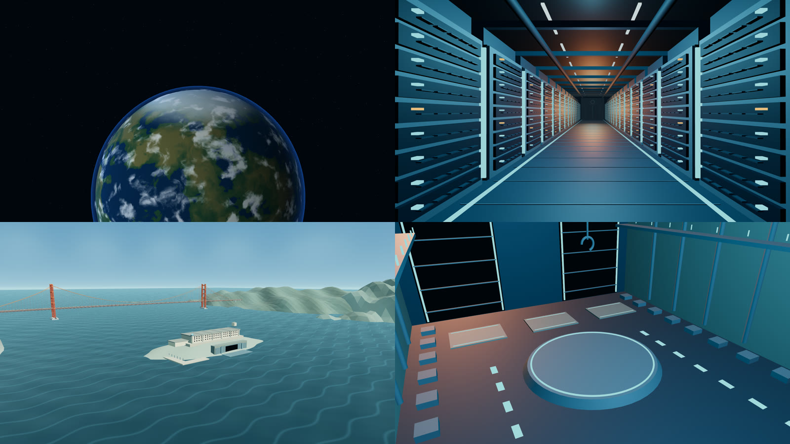

# Production Environment Banks

Open `production_viewer.html` on the bank's local server. Choose **Space / Data center / Alcatraz**, then choose a camera and lighting. Playback, scrubbing and 1080p PNG export work across the three sets. The original bridge viewer and robot-flight viewer remain separate entry points.



## Space

Three cameras: limb, orbit, open staging area. Two treatments: sunlit and terminator. A procedural globe, fractal coastlines/clouds, atmospheric rim and deterministic star field provide a reusable presentation/vehicle background. The globe is Earth-inspired but its geography is invented; do not use it as a real map. No characters, vehicle designs or remote imagery are included.

## Data center

Three cameras: central aisle, low angle, lateral move. Normal, alert and standby lighting. Repeated server bays, ventilation slots, status lights, overhead pipes/cable trays, structural beams and a long floor perspective provide a human-scale action environment. This is a production set, not a depiction of an actual company's facility. The bug army and fight choreography are not built into the background.

## Alcatraz sandbox base

The artist confirmed Alcatraz as the fictional sandbox base. The bank adds an island, cellhouse-inspired silhouette, water tower, lighthouse, dock, sliding sea-level doors and a separate underground hangar view to the shared Golden Gate environment. Day, sunset, night and dawn are available.

Cameras: island overview, gate approach, dock, underground hangar. Gate leaves open from seconds 1–4. The underground staging volume is 180×140×240 world units and includes a lift/landing platform, service cradles, columns and raised catwalks. The sea-level door is a smaller vehicle/service exit; it is not a validated clearance route for the full-size robot. A full robot launch will need a matching vertical-lift or submerged path; the sea-split module is ready for that later shot.

Island geography and building dimensions are artistic staging, not a surveyed Alcatraz reconstruction. The fictional hangar and lighting are not claims about real facilities or current political plans. No cockpit or command-room design has been decided.

## Source and capture

`production_sets.js` builds the environments through `ProductionSets.build(name)`. Sets expose `scene`, `camera`, `shots`, `lightingOptions`, `setLighting(name)` and `sample(shot, seconds)`.

```js
ProductionLab.setEnvironment('data_center');
ProductionLab.render('aisle', 2.5, 1920, 1080, 'alert');
```

```sh
deno run --allow-net=127.0.0.1:9231 --allow-write=review tools/capture_production.mjs stills review/production
deno run --allow-net=127.0.0.1:9231 --allow-write=review tools/capture_production.mjs preview review/production/preview_frames
ffmpeg -framerate 12 -i review/production/preview_frames/frame_%04d.png -r 24 -c:v libx264 -crf 19 -pix_fmt yuv420p review/production/environment_preview.mp4
```

The 18-second review joins one six-second move per environment; it samples 12 poses/s, encoded at 24 fps with two-frame holds. Manual/browser rendering is sampled at the requested time without that review restriction. Validation checks random-access frame reproducibility, stable scene node counts and WebGL errors across all three sets. Original source files and existing views are preserved.

These are first reusable environment passes for art-direction review. Their final character scale, staging, lighting and action cameras should be refined against the artist's actual shot drawings rather than treating a clean render as proof of a finished animated scene.
