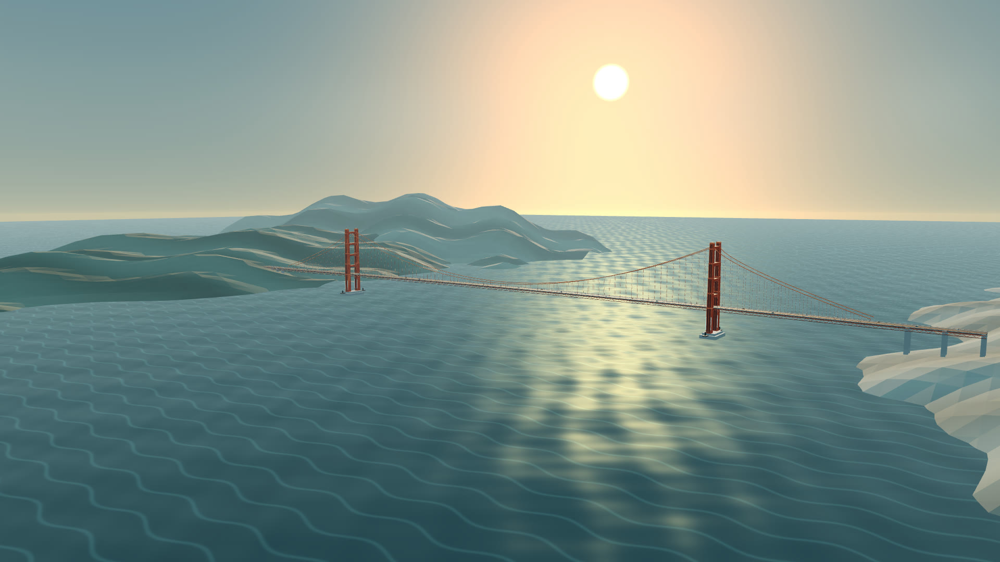
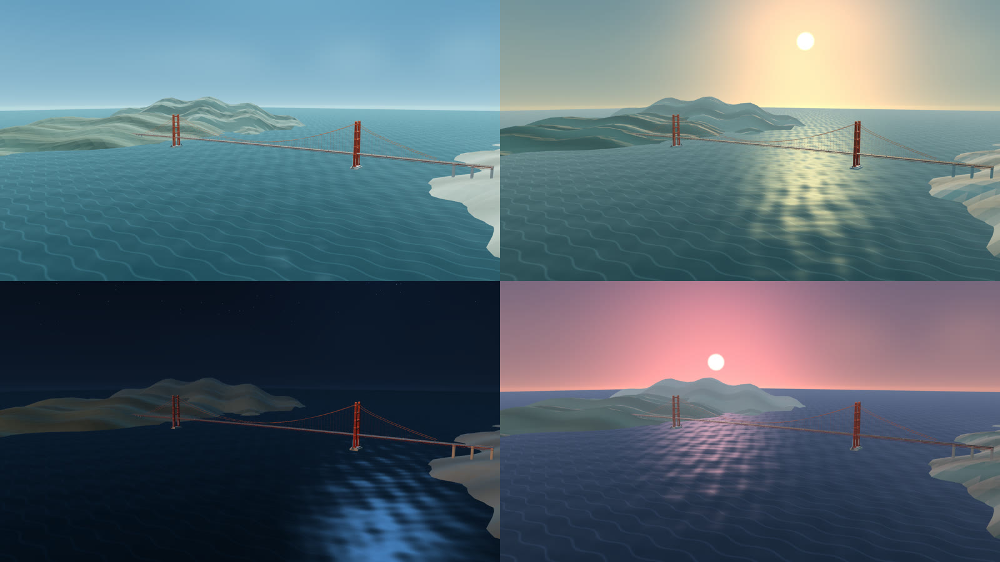

# Golden Gate — Reusable Environment Bank

A procedural Three.js background set for the Antigravity opening, ending and production presentation. This is the first environment pass, not a final character-composited shot.



## Open

Open `index.html` in a desktop browser, or serve this folder locally:

```sh
python3 -m http.server 8791 --bind 127.0.0.1
```

No build step, package installation, generated artwork, downloaded textures or remote runtime. Three.js r149 and its MIT notice are included locally.

Choose **Day / Sunset / Night / Dawn**, choose a camera and render layer, play/scrub time, toggle SF lights, and use Save PNG for a 1920×1080 image. Camera choreography is sampled from absolute seconds; it does not depend on playback history. PNGs are suitable as Clip Studio reference/background layers. Source artwork and helmet designs remain separate.

## Lighting bank

Four lighting profiles share the same geometry, cameras and time samples. Sky, sunlight/moonlight, ambient light, tower fill, sea color/highlights, coastal haze and night stars change together. They are artistic treatments, not an astronomical simulation.

`lighting_profiles.js` contains all adjustable profiles. `BridgeLab.setLighting('night')` switches programmatically; `?lighting=night&shot=opening` opens a specific view. Saved PNG names include lighting, camera and render layer.



## Camera bank

| Shot | Duration | Use |
| --- | --- | --- |
| `opening` | 6 s | Wide bridge reveal, slow inward drift |
| `tower` | 5 s | Portal, cable and roadway detail |
| `passage` | 6 s | Water-level approach through the central span |
| `ocean` | 6 s | Continue out across open water; space reserved for the robot |
| `ending` | 6 s | Reverse-side panorama, slow pullback |

`review/camera_preview.mp4`, when supplied locally, joins opening, passage and ending: 18 seconds, no sound. The review video samples 12 poses/s and encodes 24 fps by repeating each pose twice. Browser playback and manual PNG exports are not restricted to that review sampling rate.

## Reuse and compositing

```js
const set = GoldenGateBank.build();
set.setLighting('dawn');
set.sample('opening', 2.5);
set.setScifi(false);
set.setLayer('bridge'); // beauty | bridge | environment
```

The preview exposes:

```js
BridgeLab.render('opening', 2.5, 1920, 1080, 'beauty');
BridgeLab.render('opening', 2.5, 1920, 1080, 'environment');
BridgeLab.render('opening', 2.5, 1920, 1080, 'bridge');
BridgeLab.renderer.domElement.toDataURL('image/png');
```

Use the same shot/time/resolution for every layer. `bridge` renders structure and road traffic on transparent pixels; `environment` renders sea, sky, terrain and city without the bridge. For a robot behind the entire bridge: environment → robot → bridge. If the robot intersects individual cables/portals, an extra occlusion mask or a shared 3D scene is needed; a single bridge layer cannot express every depth crossing.

All camera presets and dimensions live in `bridge_scene.js`. Repeated structural elements use instancing; the inspected opening render uses 98 draw calls rather than the first implementation's 3,523. Runtime performance still depends on the device and output size.

## Capture

Use a separate temporary Chrome profile with a local debugging endpoint. Do not attach the capture script to a personal browsing profile. The script only selects a blank render tab or a tab already at this local scene.

```sh
deno run --allow-net=127.0.0.1:9231 --allow-write=review tools/capture.mjs stills review
deno run --allow-net=127.0.0.1:9231 --allow-write=review tools/capture.mjs lighting review/lighting
deno run --allow-net=127.0.0.1:9231 --allow-write=review tools/capture.mjs preview review/preview_frames
ffmpeg -framerate 12 -i review/preview_frames/frame_%04d.png -r 24 -c:v libx264 -crf 19 -pix_fmt yuv420p review/camera_preview.mp4
```

Default endpoints: scene `127.0.0.1:8791`, dedicated Chrome `127.0.0.1:9231`. `capture_metrics.json` records sampled cameras, renderer statistics, deterministic random-access comparison and WebGL error checks. The review capture uses 1080p stills and a 720p sequence.

## Art direction and limits

- Twin International Orange towers, stepped Art Deco portals, paired suspension cables, hangers, deck truss and road traffic establish the landmark.
- Dimensions follow the [Bridge District's published figures](https://www.goldengate.org/bridge/history-research/statistics-data/design-construction-stats/): 1,280 m main span, 227 m tower height, 27 m width. The center roadway is placed at 75 m, based on the stated 152 m tower height above the roadway.
- Terrain, city placement, atmosphere, camera positions and cyan SF details are artistic staging, not a surveyed reconstruction. The SF layer is fictional.
- Sea uses analytic waves and sun highlights. It does not reflect the bridge or simulate a robot's sea-splitting wake.
- No robot, bug army, base, cockpit or new helmet has been added. These are separate production assets; the central flight corridor is available for later compositing.
- This first pass needs the artist's review of silhouette, color and staging before being treated as the final recurring bank scene.

## Scope

The artist authorized publication of this environment bank. Source drawings remain separate. No blanket license is granted for project-specific material. Third-party Three.js remains MIT; see `vendor/THREE-LICENSE.txt`.
