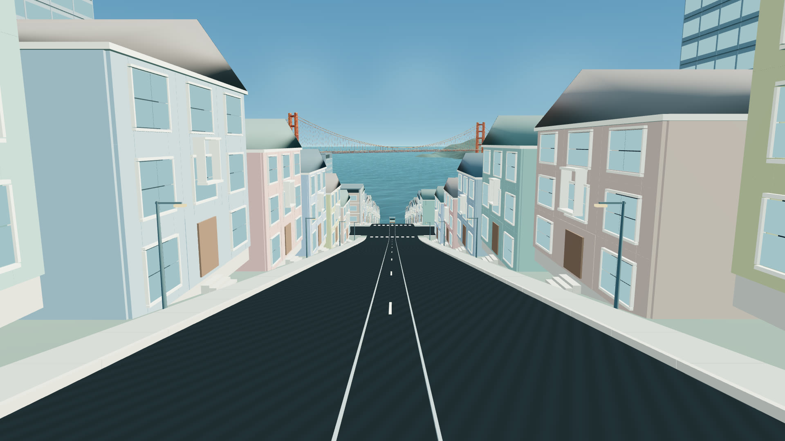
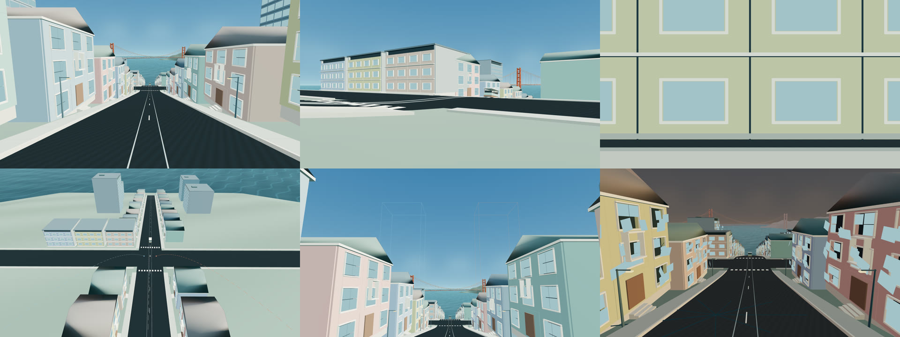
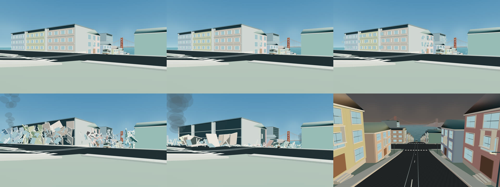
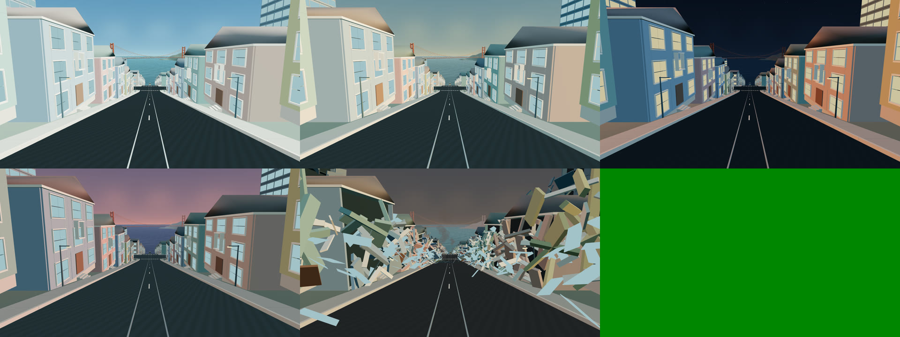

# SF Downtown — Reversible Damage Bank

A procedural cel-flavored downtown set for the artist's recurring action scenes. It shares the Golden Gate bank's atmosphere, lighting and distant bridge, while providing its own hillside, architecture, tram and reversible damage system. This is fictional staging, not a survey of real streets.



## Open

Keep `sf_downtown_bank` beside `golden_gate_bank` under the repository's `environments` folder. Start the server from `environments`:

```sh
python3 -m http.server 8793 --bind 127.0.0.1
```

Open `http://127.0.0.1:8793/sf_downtown_bank/index.html`. The standalone ZIP preserves this sibling layout and includes the minimal Golden Gate dependencies. No installation or build step is required.

Viewer controls: camera shot, day/sunset/night/dawn/battle haze, beauty/city/debris/environment, a single Damage slider, playback, time scrub and 1920×1080 PNG export. Rollback drives Damage automatically from 1 to 0; its slider displays that value and is disabled during this shot.

## Shots

| Shot | Framing / purpose |
| --- | --- |
| `hill_street` | Steep street toward the bay; Golden Gate visible in the distance |
| `intersection` | Human-scale open intersection for staging a fight |
| `side_stage` | Fixed orthographic side-stage framing, nine world units tall; floor contact is visible near the bottom |
| `rooftop_summon` | Rooftops and three dashed flight-path markers ending near prospective owner positions |
| `giant_battle` | Low wide framing with two wireframe volume placeholders, approximately 105 world units tall |
| `rollback` | Six-second damage restoration, 1 → 0; debris follows its stored route back into the facade |

No character, vehicle-owner or monster designs are invented. Summon markers and giant boxes are staging volumes only. The generic street tram is part of the city set, not a new character vehicle.



## Damage: one reversible control

```js
DowntownLab.render('intersection', 2.5, 0.75, 1920, 1080, 'beauty', 'sunset');
```

The module can also be reused directly:

```js
const bank = DowntownBank.build();
bank.setLighting('day');
bank.setDamage(0.75);
bank.sample('intersection', 2.5);
bank.setSize(1920, 1080);
// Render bank.scene with bank.camera.
```

- 0: assembled architecture, unbroken windows, upright lamps/tram and intact roads.
- Early damage: branching cracks appear.
- Intermediate damage: window pieces fall, then facade sections, trim and rail sections detach.
- Heavy damage: facade panels pile near streets, poles fall, the tram tilts, road/terrain surfaces open over crater bowls and pooled smoke appears.
- 1 → 0: all the same transforms are interpolated in reverse. Nothing is accumulated, integrated or randomly respawned during playback.

Every physical debris piece stores immutable original position, quaternion, scale and matrix; grouped lamps and tram also preserve their original transforms. `bank.originalTransforms` exposes the complete source catalog. `review/home_transforms.json` is a captured copy. Collapsed target transforms and activation thresholds are seeded once during construction. Sampling at the same shot, time, damage, light and output size is repeatable after arbitrary seeks.

This is an authored reversible collapse, not a structural/rigid-body simulation. Pile pieces may overlap. Roofs and structural side/back walls remain; the effect is facade collapse, not whole-building demolition. No changes to existing character/robot banks are required.



## Layers

- `beauty`: all active content.
- `city`: remaining city surfaces, road, intact panes and assembled objects on alpha; includes the appropriate shot markers.
- `debris`: detached facade/glass/rails, fallen objects, crater bowls and smoke on alpha.
- `environment`: sky, water, distant bridge/headlands and local hillside terrain.

Both road and terrain are cut at the same crater locations. Layer exports are isolated assets; they are not depth holdout mattes. Use beauty as the authority where foreground geometry crosses another layer. Damage zero produces a fully transparent debris pass.



## Construction and art direction

- Steep streets, stepped generic row houses, gables, shallow bay-window trim, office blocks, lamps, rails and an original wood/cream tram.
- No business signs, logos, route numbers or readable text inside the rendered set. UI labels are outside the exported image.
- No copied cable-car livery, pyramid-shaped signature skyscraper or rounded signature landmark tower. The older bank's generic distant city is hidden; only the specifically requested Golden Gate and headlands are reused.
- Repeated architecture and both intact/debris copies use instancing. Matrices are updated in fixed buffers; sampling does not add scene nodes or pieces.
- Five lighting variants are artistic presets, not a geographic or astronomical reconstruction.

## Capture and verification

Use a dedicated temporary headless Chrome profile on port 9231. The capture script only selects a blank tab or the known local bank servers, not arbitrary personal browsing tabs.

```sh
deno run --allow-net=127.0.0.1:9231 --allow-write=review tools/capture.mjs stills review
deno run --allow-net=127.0.0.1:9231 --allow-write=review tools/capture.mjs preview review/preview_frames
ffmpeg -framerate 24 -i review/preview_frames/frame_%04d.png -c:v libx264 -crf 19 -pix_fmt yuv420p review/downtown_preview.mp4
```

The short preview shows the intact hill, progressive damage and the full rollback, including a final zero-damage frame. Review captures cover every shot, damage stages, all lighting variants, alpha passes and an overhead view of the damage. `review/metrics.json` records semantic checks: exact pixel repair after other shots/lighting, original-transform immutability, stable node count, empty intact debris, damaged debris alpha, orthographic projection, cameras above terrain, rollback ending intact, persistent manual damage control and WebGL/shader errors.

## Scope and handoff

Private production asset. Preserve the sibling Golden Gate files and their Three.js MIT notice. No blanket license is granted for project-specific designs/code. Use `the artist` in production files and noreply commit identities. See `HANDOFF.md` for the current production boundary.
