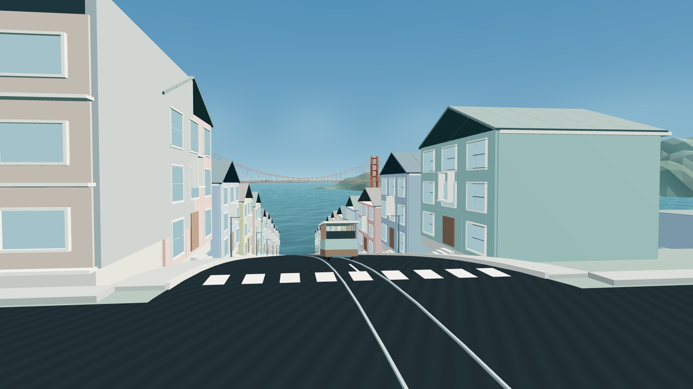
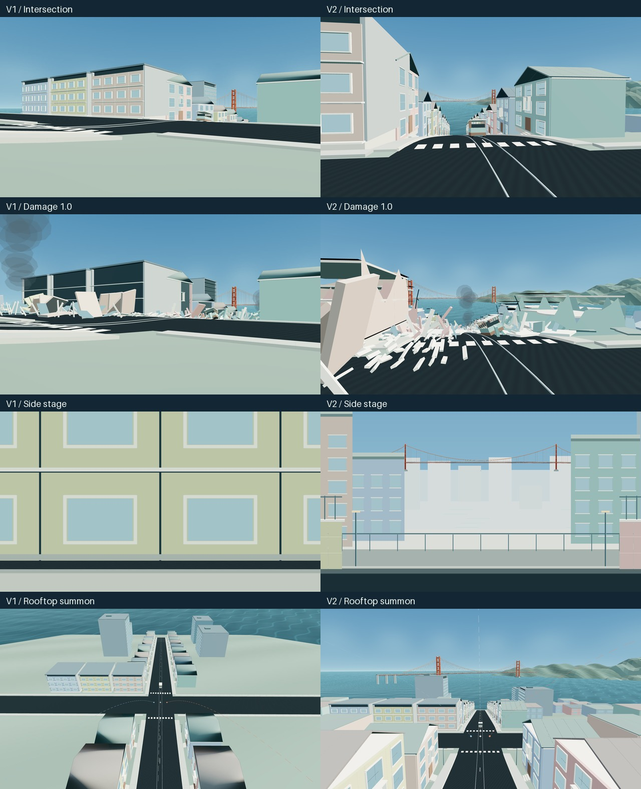
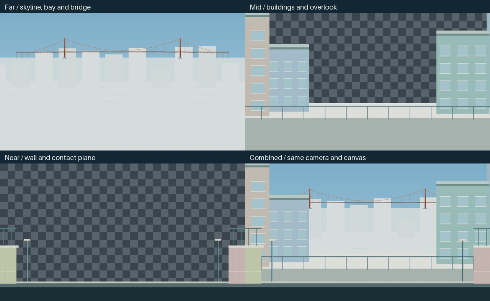

# SF Downtown v2 — Staging, Ruins and Parallax

This additive revision addresses the artist's staging review. The original viewer, source and captures remain unchanged. Use **`index_v2.html`** for the revised bank.



## Open

Keep this bank beside `golden_gate_bank` in `environments`. From `environments`, run:

```sh
python3 -m http.server 8793 --bind 127.0.0.1
```

Open `http://127.0.0.1:8793/sf_downtown_bank/index_v2.html`. No build or external download is required. The same Three.js MIT notice and sibling bridge/lighting dependencies apply.

## Changes

- **Intersection:** camera moved onto the road inside the intersection, slightly raised, with buildings on both sides. The nearby facades and tram now frame the action rather than an empty hillside foreground.
- **Damage:** roof plates and roof trim detach through the existing Damage value. Continuous structural shells recede into jagged wall remnants; chipped floor slabs become exposed. Window/wall cracks reach readable thickness around 0.18–0.20. Outer blocks fill visible empty lots.
- **Rooftop summon:** camera travels at neighboring roof height toward the bay. It stays over the street corridor to avoid clipping through a roof. The three path markers remain.
- **Side stage:** a separate forced-perspective scenic extension provides foreground wall/street, middle buildings/overlook and distant skyline/bay/Golden Gate. It uses one static orthographic camera. Near and middle scenery respond to the same Damage control.



## Parallax sheets

Select `side_stage`. **Parallax** previews relative horizontal movement. **Export 3 layers** downloads a single ZIP with 1920×1080 PNGs, a `stage.json` guide and a short README. Current lighting and Damage are baked in; preview offsets are temporarily reset for export and restored afterward.

Stack bottom to top:

| PNG / layer | Content | Suggested travel ratio |
| --- | --- | --- |
| `parallax_far` | Sky, skyline, bay and miniature Golden Gate scenery | 0.12 |
| `parallax_mid` | Mid-distance buildings, street/overlook and balustrade | 0.40 |
| `parallax_near` | Foreground contact plane, low wall, lamps and damage | 1.00 |

Keep all original canvas bounds and image origins. Do not trim transparent borders independently. The near and middle passes have alpha; the far pass supplies the full background. Ratios are art-direction starting points. The exported `stage.json` includes the shared projection and a center foot-contact pixel. The pre-rendered day/intact set is also supplied as `review_v2/side_stage_parallax.zip`.

The orthographic vertical span is 26 world units; character scale is left for the artist. The suggested action range is local x=-16…16, local y=`bank.ground(80)`, z≈96. The distant bridge is a scaled clone of the existing bridge geometry, used as a scenic miniature so orthographic projection can show its complete span. It is not a geographic reconstruction or a second world-scale bridge for robot interaction.



## API

The revised module exposes `DowntownBankV2.build()`. The viewer retains `DowntownLab.render`:

```js
DowntownLab.render('intersection', 2, 1, 1920, 1080, 'beauty', 'battle_haze');
DowntownLab.render('side_stage', 1.5, 0.5, 1920, 1080, 'parallax_mid', 'day');
DowntownLab.bank.setParallaxOffset(2); // near=2, mid=0.8, far=0.24 world units
```

Ordinary layers remain `beauty`, `city`, `debris`, `environment`. For `side_stage`, `city` contains assembled near/mid scenery and `debris` its detached pieces. Far scenic content belongs to `environment`. The three `parallax_*` layers are specific to `side_stage`; the viewer selects that shot when choosing one. Reset the offset to zero for aligned exports.

The immutable catalog in `review_v2/home_transforms.json` includes every revised physical debris piece, including roofs and side-stage debris. Absolute sampling still uses stored home/target transforms and seeded construction. Structural shells also retain their original position/scale; ruin geometry and floor visibility derive directly from Damage. No motion is accumulated.

## Review and checks

`review_v2/downtown_v2_preview.mp4` shows intersection framing, damage progression, full rollback, rooftop travel and parallax movement. No characters or sound are included. The optional `tools/contact_v2.py` review-sheet helper requires Pillow; the viewer itself has no additional dependencies.

`tools/capture_v2.mjs` uses a dedicated temporary headless Chrome on port 9233. It only selects blank or known localhost bank tabs. Run from this bank:

```sh
deno run --allow-net=127.0.0.1:9233 --allow-write=review_v2 tools/capture_v2.mjs stills review_v2
deno run --allow-net=127.0.0.1:9233 --allow-write=review_v2/preview_frames tools/capture_v2.mjs preview review_v2/preview_frames
ffmpeg -framerate 24 -i review_v2/preview_frames/frame_%04d.png -c:v libx264 -crf 19 -pix_fmt yuv420p review_v2/downtown_v2_preview.mp4
```

QA covers cross-build determinism, immutable home transforms, exact repaired pixels after arbitrary damage/lighting/shot seeks, stable node count, alpha passes, camera clearance, zero-damage rollback endpoint, persistent manual damage, visible side-stage damage and exact stage repair. Additional checks compare all three parallax projections and recompose the actual rendered passes. Tiny antialiasing differences at isolated edges are recorded separately from exact damage repair. WebGL/shader errors are checked.

## Production limits

Damage is an authored collapse, not structural physics. Debris may overlap; exposed slabs are deliberately retained as ruins and may need shot-specific support art. The city has no underground interiors. Near/mid parallax damage is supported; the far skyline/bridge scenic plate stays intact. Ordinary isolated city/debris passes are not depth holdout mattes.

No signage, logos, readable scene text, copied commercial tram livery or new character designs are added. Use `the artist` in production files and noreply commit identities. See `HANDOFF_v2.md` for integration notes.
