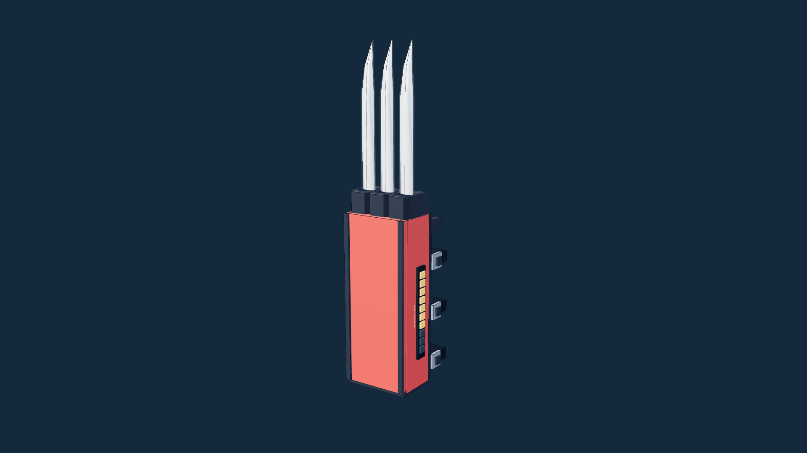
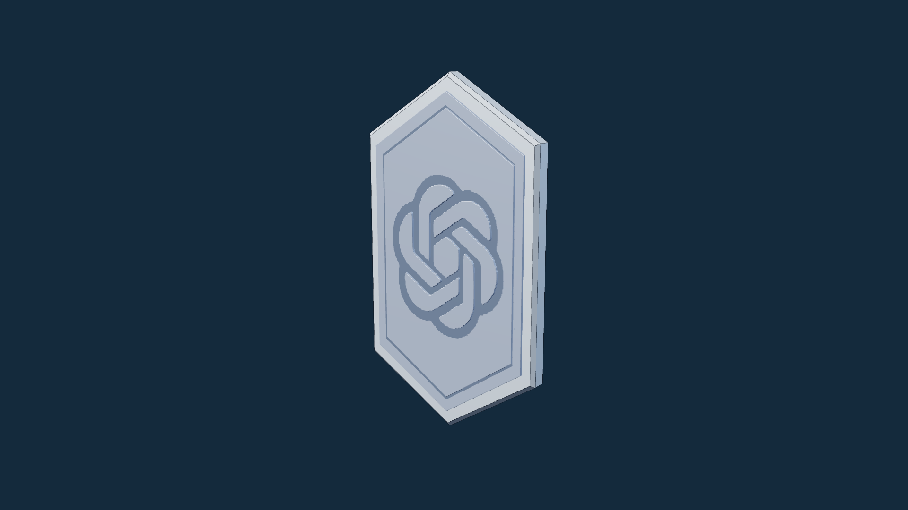

# Hero Weapon Reference Bank

Reusable, metre-scale Three.js props for tracing and animation blocking. The artist's sword, shield and claw drawings take precedence over the earlier generic functional brief. This bank adds props without changing the character puppet or public robot repository.



## Open the viewer

Open `index.html` in a desktop browser, or serve this folder:

```sh
python3 -m http.server 8799 --bind 127.0.0.1
```

Then open `http://127.0.0.1:8799/index.html`. No build step, external assets or network runtime is required. Three.js r149 and its MIT notice are included in `vendor`.

Choose a weapon and state, then drag to orbit or use Front / Three quarter / Side / Back / Top / Low. Wheel zoom, turntable rotation, progress scrubbing, outline toggle, flat tracing colours and light/dark stages are available. **Save 1080p transparent PNG** exports the current angle and layer at 1920 × 1080. Stop playback before exporting matched layers.

## Props and confirmed design choices

| Prop | States | Design |
| --- | --- | --- |
| Gemini flash blades | `twin`, `docked`, `hilts` | Two black grips and pommels with silver upper sleeves, each with one recessed four-point sparkle; pommel-to-pommel docking. One selected beam colour at a time: blue, red, yellow or green. No simultaneous rainbow striping. |
| Claude session claws | `retracted`, `drawn`, `complete` | Large rectangular hollow forearm case, three angular blade ports, three fastening straps and one rigid palm crossbar. White claws in both drawn and complete states; completion fills the gauge. Small side-mounted session-limit gauge. |
| GPT constellation shield | `held`, `thrown`, `wall`, `sphere` | Elongated hexagonal physical shield with rear grips. Knot symbol and inset hexagonal border are recessed geometry, never white surface paint. Telekinetic constellation path, a wall of hex tiles and a folding energy cage. No star emblem or dome state. |

The four Gemini colours are selectable ability modes. Their individual story effects remain for the artist to define; changing the colour does not invent an ability.

The Claude cage is approximately 0.47 m long and 0.19 m wide, with 0.39 m claws. The original angular black exit frames project 0.045 m farther forward, retaining their original cross-section. Each full-length claw translates 0.460 m through a clear port into the case; it does not shrink. The straps sit at the wrist, middle forearm and rear forearm. The palm crossbar adds a firm grip while the straps support the case. Plain translucent hand/forearm guides show scale only.

The shield body is about 1.10 × 0.60 m. Its front plate has actual cutouts, bevel walls, raised interior islands and recessed floors about 8.9 mm below the face. The contour data was measured from the supplied symbol reference. No original drawing or reference photograph is republished.



## Layers

- `beauty`: physical prop, effects and optional guide.
- `solid`: physical prop only, including the solid claw blades and shield engraving.
- `effects`: beams, claw glow, constellation points/trail and sphere field. Solid geometry remains as an invisible depth mask for correct occlusion.
- `guide`: only the plain hand/forearm or generic enclosed target volumes.

Export layers at the same weapon, state, progress, angle and zoom. Transparent effects can be composited above the solid pass in Clip Studio. The review video uses a dark stage to keep the coloured beams and constellation line readable. Flat mode removes physical lighting from solid materials; effects keep their controlled transparency.

## Reuse API

Load `vendor/three.min.js`, `weapon_profiles.js`, `shield_engraving.js` and `weapon_bank.js` in that order.

```js
const prop = WeaponsBank.build('claude');
prop.sample('drawn', 0.14); // normalized progress; half extension
prop.setLayer('solid');
prop.setOutline(true);
prop.setFlat(false);
prop.setGuide(false);
// prop.root contains the model and can be attached to a parent scene.
```

`sample(state, progress)` is a deterministic absolute sample, independent of playback history. Objects are built once and reused. It returns a suggested target and camera span. `setBeamColor('green')` selects a single Gemini beam colour. `setEmblem(false)` hides the GPT carved front plate for a plain base-plate comparison.

The browser capture entry point is:

```js
WeaponsLab.render({
  weapon: 'gpt', state: 'thrown', progress: 0.65,
  view: 'three_quarter', layer: 'effects',
  guide: false, width: 1920, height: 1080, alpha: true
});
```

`weapon_profiles.js` stores palette choices and reference measurements. Geometry and attachment locations live in `weapon_bank.js`; most dimension entries are descriptive, not a universal resizing control. Claude `dimensions.claw` and `dimensions.portProjection` drive blade length and exit-frame projection together with storage travel. Helmet/suit colours and combined-robot colours remain independent.

## Review and verification

`review` contains 35 PNGs, including all ten states, alternate angles, all four Gemini colours, half-drawn claws, transparent layers and flat tracing examples. `weapons_preview.mp4` is a silent 12-second preview at 1280 × 720: Gemini colour changes and docking, Claude extension and completion, then GPT throw/wall/fold. It samples 12 poses per second and encodes 24 fps by repeating each pose twice.

`metrics.json` records deterministic pixel equality after random-access state changes, stable scene object counts, finite geometry and WebGL status for all ten states. `design_checks.json` verifies three straps, a palm grip, rigid claw dimensions during extension, full storage within the case, transparent nonempty layers and single-colour beams and recessed sparkle floors.

The capture tools use a separate temporary Chrome profile on debugging port 9237, and a local server at port 8793 whose root contains `weapons_bank`. They select only a blank render tab or the known local reference-bank tab, never a personal browsing session. Change the explicit local port/URL if your setup differs.

```sh
deno run --allow-net=127.0.0.1:9237 --allow-write=review tools/capture.mjs stills review
deno run --allow-net=127.0.0.1:9237 --allow-write=review tools/verify.mjs verify review
deno run --allow-net=127.0.0.1:9237 --allow-write=preview_frames tools/capture.mjs preview preview_frames
ffmpeg -framerate 12 -i preview_frames/frame_%04d.png -r 24 -c:v libx264 -crf 19 -pix_fmt yuv420p review/weapons_preview.mp4
```

## Scope

This is an illustration reference bank, not a manufactured mechanism or final combat animation. The wall/sphere uses 37 reusable hex tiles. Gaps in the spherical tile arrangement are spanned by the separate energy field; it is not a sealed all-hex polyhedron. Held-shield and tile modes are alternate representations, not a topology-preserving mesh fracture. The existing puppet's hand sockets are not yet connected to these props.

The vendor license applies to Three.js only. This package does not assign a new open-source license to the artist's designs or project assets. See `HANDOFF.md` for next integration steps.
